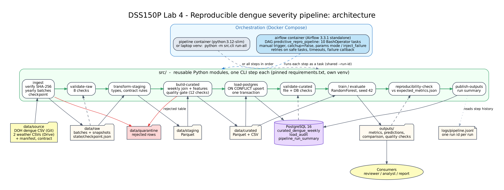

# DSS150P Lab 4: Reproducible Dengue Severity Pipeline

Individual DSS150P (Fundamentals of Data Engineering) reproduction of a group Predictive
Analytics project: **predicting weekly dengue severity (Low / Moderate / High) for 41
Philippine cities, 2016-2021**, from DOH dengue surveillance data and daily weather.

The goal is **not** a better model. It is a data product that anyone can clone, run and get
the **same result** from the same source data:

| | Group baseline (notebook 12) | This pipeline |
|---|---|---|
| Severity macro-F1 (primary) | 0.494 | **0.4972** (diff +0.0032, tolerance ±0.01: **PASS**) |
| Severity accuracy | 0.717 | 0.7184 |
| Model-ready rows / split date | 10,433 / 2020-01-12 | 10,433 / 2020-01-12 (identical) |

Identical metrics were produced on Windows (venv), Linux (Docker) and inside Airflow.
Details: [`docs/reproducibility_report.md`](docs/reproducibility_report.md).

---

## Architecture



**Layers:** `data/source` (immutable, checksummed) -> `data/raw` (byte-exact copies + yearly
batches with audit columns) -> `data/staging` (typed, validated Parquet) -> `data/curated`
(weekly join + features, the model-ready data product) -> PostgreSQL + `outputs/`.
Rejected rows go to `data/quarantine` with a reason.

Dataset-level lineage (fields and row counts through every layer): [`docs/lineage.png`](docs/lineage.png)

## Repository layout

```
config/settings.yml          every path, seed and model parameter (no hard-coded paths)
config/city_mapping.yml      DOH location -> weather city (moved out of the group notebook)
data/source/                 original files (dengue CSV committed, weather from Google Drive)
metadata/                    source_manifest.yml, source_profile.md, data_contract.yml,
                             expected_metrics.json, split_manifest.json
src/                         one module per concern, all steps run through src/cli.py
sql/schema.sql               PostgreSQL tables (curated table, load audit, run summary)
dags/                        Airflow DAG: orchestration only, no business logic
tests/                       5 unit + 4 integration tests (pytest)
outputs/                     metrics.json, predictions.csv, metrics_comparison.json,
                             quality/*.json, run_summary.json
docs/                        architecture, lineage, runbook, benchmark and reproducibility reports,
                             evidence/ (run logs and screenshots)
```

Additions beyond the required structure (same separation of concerns):
`src/common.py` (run IDs, structured logging), `src/profile_source.py`, `src/benchmark.py`,
`src/publish.py`, `Dockerfile.airflow`, `config/city_mapping.yml`, `state/` (ingestion
checkpoint), `logs/` (JSON-lines log), `docs/evidence/`, `docs/diagrams/` (diagram sources).

---

## Prerequisites

- **Git**
- **Docker Desktop** (Docker Compose v2), with about 4 GB of free disk for the images
- *Optional, for running without Docker:* **Python 3.12+** (tested with 3.12 and 3.14)

## Setup from a clean machine

### 1. Clone

```bash
git clone https://github.com/zo-good/DSS150P_REPRO_CANDELARIA_ZOEH.git
cd DSS150P_REPRO_CANDELARIA_ZOEH
```

### 2. Place the source data

| File | Where to get it | In Git? |
|---|---|---|
| `doh-epi-dengue-data-2016-2021.csv` | already in `data/source/` ([HDX](https://data.humdata.org/dataset/philippine-dengue-cases-and-deaths)) | yes (1.5 MB) |
| `daily_data_combined_2010_to_2019.csv` | [Google Drive folder](https://drive.google.com/drive/folders/18Tmi2SxdWr6jmoDS41KWBW-rr8IxRD-G?usp=sharing) | no (88 MB) |
| `daily_data_combined_2020_to_2023.csv` | same folder | no (32 MB) |

Put the two weather files in `data/source/` **with these exact names**. Do not open and
re-save them in Excel: that changes the bytes and the checksum check will (correctly) fail.
Expected SHA-256 values are in [`metadata/source_manifest.yml`](metadata/source_manifest.yml).

### 3. Environment file

```bash
cp .env.example .env            # PowerShell: Copy-Item .env.example .env
```

The defaults work as-is for a local run. `.env` is git-ignored and must never be committed.

---

## Running the pipeline

Choose **one** of the three ways. All run the same 10 steps:
`ingest -> validate-raw -> transform-staging -> build-curated -> load-postgres ->
validate-curated -> train -> evaluate -> reproducibility-check -> publish-outputs`

### A. Airflow (recommended)

```bash
docker compose up -d --build airflow     # first build ~5-10 min (Airflow image ~1 GB)
```

1. Open **http://localhost:8080** (no login in this local setup).
2. Switch **`predictive_repro_pipeline`** on (new DAGs start paused).
3. **Trigger** with the defaults: `mode = incremental`, `inject_failure = none`.
4. All 10 tasks turn green in about 1.5 minutes.

Parameters: `mode = full` rebuilds the raw layer from source; `inject_failure =
negative_cases | duplicate_key | missing_column` runs the failure-injection demo.

### B. Docker, without Airflow

```bash
docker compose up -d postgres
docker compose build pipeline
docker compose run --rm pipeline         # runs: python -m src.cli run-all
```

### C. Local Python + Dockerized PostgreSQL

```bash
python -m venv .venv
source .venv/bin/activate                # PowerShell: .\.venv\Scripts\Activate.ps1
pip install -r requirements.txt
docker compose up -d postgres
python -m src.cli run-all
```

Single steps can be run on their own, e.g. `python -m src.cli verify-source` or
`python -m src.cli train`. See `python -m src.cli --help`.

---

## Validation

```bash
python -m src.cli verify-source          # source checksums + row counts vs manifest
python -m pytest -v                      # 9 tests (DB test is skipped if Postgres is down)
python -m src.cli benchmark              # optional storage benchmark -> docs/benchmark_report.md
```

Every run also executes 22 data-quality checks (8 raw, 14 curated, rules taken from
`metadata/data_contract.yml`) and stops with a non-zero exit code if any `fail` rule breaks.

## Expected outputs after one successful run

| Output | Expected |
|---|---|
| `data/raw/dengue_batches/` | 6 files, 32,701 rows total (1 HXL label row quarantined) |
| `data/curated/dengue_weather_weekly.parquet` | 10,433 rows, 41 cities, 2016-02-07 to 2021-01-10 |
| PostgreSQL `curated_dengue_weekly` | 10,433 rows, 0 duplicate `(loc, date)` |
| `metadata/split_manifest.json` | split 2020-01-12, train 8,373 / test 2,060 |
| `outputs/metrics.json` | macro-F1 0.4972, accuracy 0.7184 |
| `outputs/metrics_comparison.json` | `"passed": true` |
| `outputs/run_summary.json` + table `pipeline_run_summary` | `status: success` |

A **second run** adds no batches (`batches_added=0`) and changes no database rows
(`inserted=0 updated=0 unchanged=10433`).

Inspect the database:

```bash
docker exec dss150p-lab4-postgres psql -U dss150p -d dengue -c "SELECT * FROM load_audit ORDER BY load_id;"
docker exec dss150p-lab4-postgres psql -U dss150p -d dengue -c "SELECT pipeline_run_id, status, curated_rows, primary_metric_value FROM pipeline_run_summary;"
```

---

## Troubleshooting

| Symptom | Cause / fix |
|---|---|
| `SourceChecksumError` | A source file differs from the manifest. Re-download it; never edit or re-save it. |
| `source file missing: data/source/...` | The weather files were not placed (Setup step 2). |
| `ModuleNotFoundError: No module named 'pandas'` | The venv is not active: run the activate command again. |
| `connection refused` on port 5433 | PostgreSQL is not running: `docker compose up -d postgres`. |
| Port 5433 or 8080 already in use | Change `POSTGRES_PORT` in `.env`, or stop the other container. |
| DAG not visible in Airflow | Wait 30 s and refresh; check `docker compose logs airflow --tail 30` for import errors. |
| `DataQualityError` | A contract rule failed. Read the `ERROR quality check` lines; the rejected table is in `data/quarantine/`. |
| `ReproducibilityError` | Metric outside tolerance; compare package versions with `requirements.txt` (see the report). |

Restart, recovery and reset procedures: [`docs/runbook.md`](docs/runbook.md).

---

## Attribution

Dataset, problem statement, feature definitions, model family and hyperparameters come from
the prior group project `dengue-ph-prediction` (Candelaria, Santos, Vicente). Dengue data:
DOH Epidemiology Bureau via HDX (published by Cirrolytix, CC BY 4.0). All engineering in this
repository (pipeline, Docker, Airflow, tests, docs) is individual work.

## AI use

Following the DSS150P generative-AI policy: an AI assistant (Claude) was used for
explanation, debugging help, and drafting code and documentation. All code was reviewed,
typed in, run and tested by me, and every number in the documentation comes from my own runs.